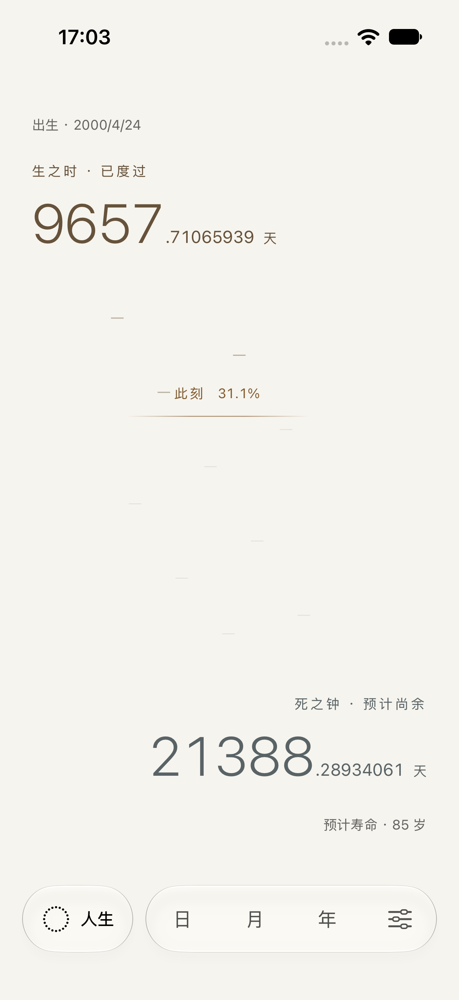
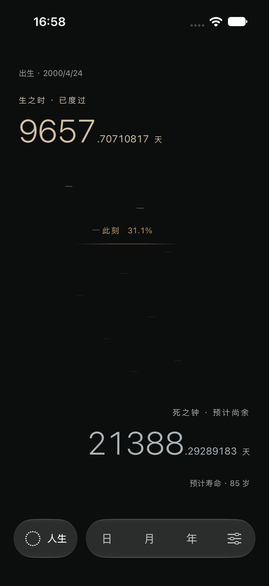
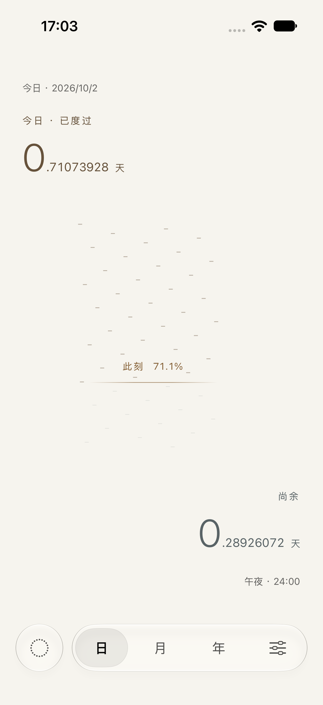
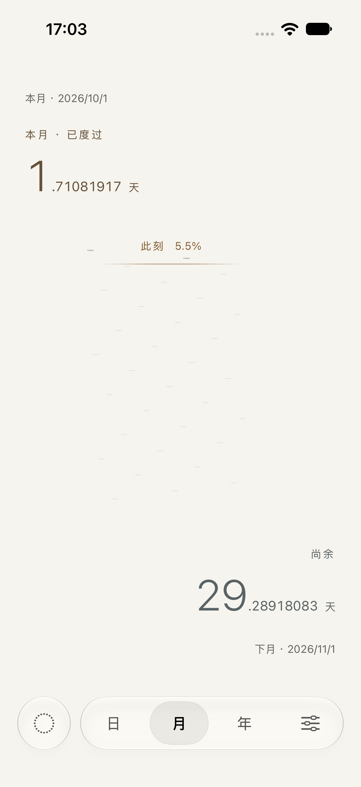
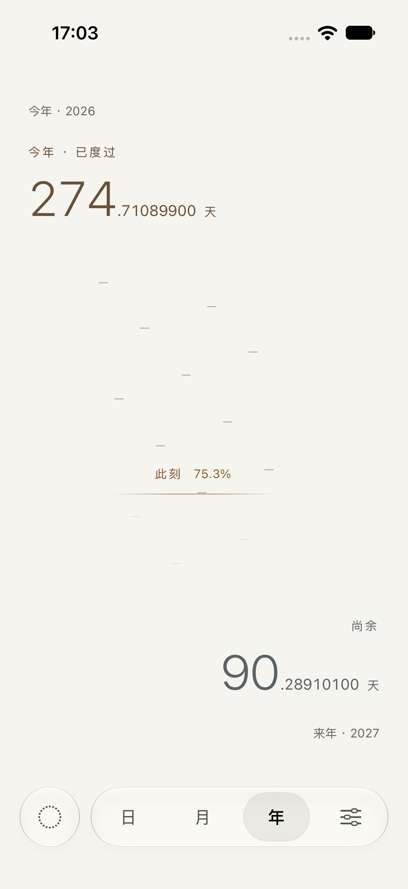
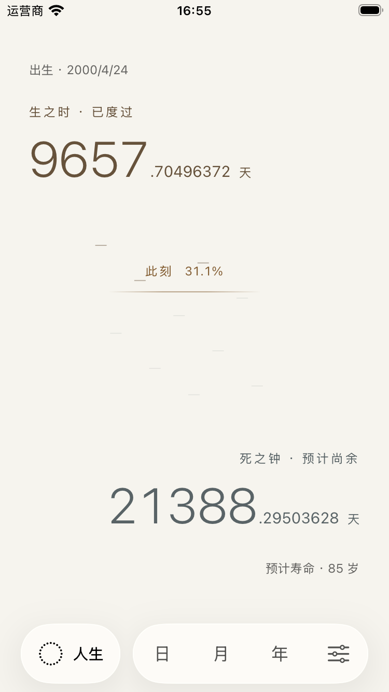
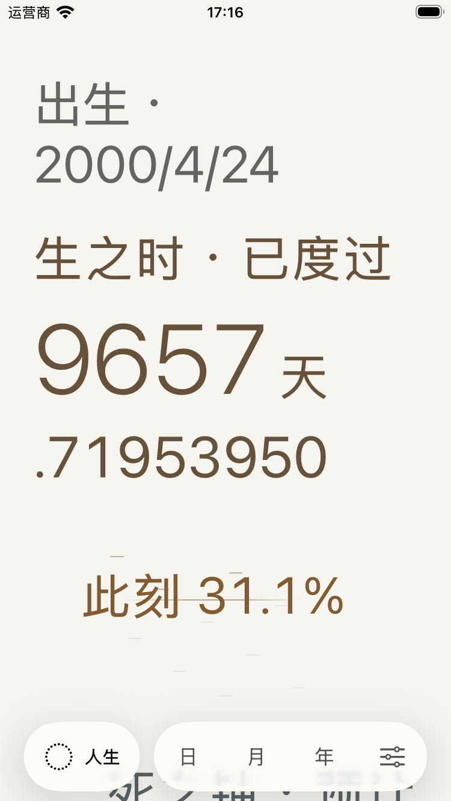
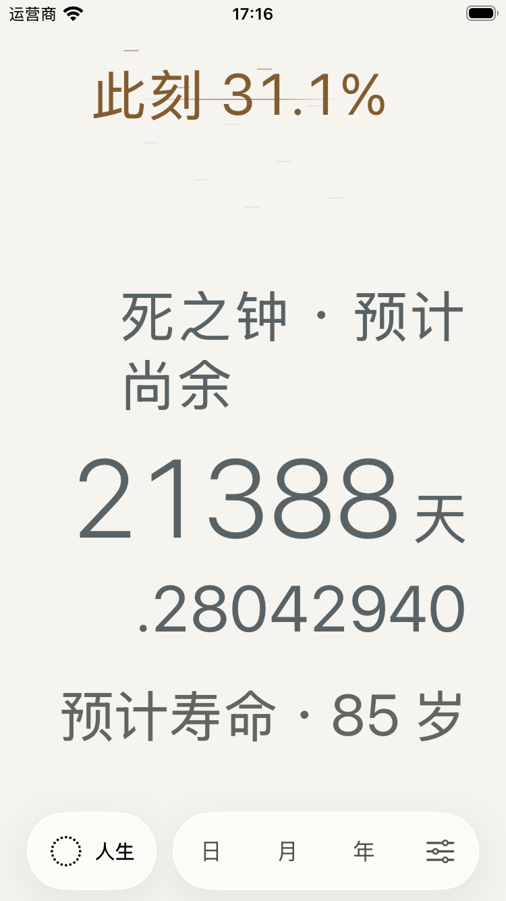

# 此刻之界 · 2026-10-02

在现有工程上实现过去／此刻／未来同时可见的时间场。保留人生默认首页、独立人生入口和日月年／设置胶囊，取消双面翻转与莫比乌斯环。主数字仍为真实的八位小数天数；出生日期和预计寿命是时间区间的依据。

## 实现

- `LifeTimeAnchors` 统一生日午夜与目标生日，非闰年闰日生日落在二月二十八日。主读数、通用计算和设置概览使用相同规则。
- `TimePhaseSnapshot` 只进行真实秒数和比例运算。高频子视图每 0.1 秒采样；日历区间、颗粒与刻点在资料变化、周期跨界、恢复前台和系统时间／时区变更时重建，最长一分钟校验一次。
- 同一个时间场按半小时、自然日、月份和十年节点逐渐变疏。缩放级别独立于保留的人生日月年导航顺序，约 0.55 秒缓入缓出；边界与颗粒位置插值，数字始终显示当前尺度的真实值。
- 边界以真实比例定位，不加速、不循环、不呼吸。在人生尺度下，短时间的位移通常小于像素；核心测试验证随真实秒数持续推进。
- 刻点的实际日期由微小标记表达，44pt 点击区按位置分组。原生菜单在独立、可比较的稳定子视图中，不因邻近数字或分钟进度刷新而重建。
- 减少动态效果直接切换空间布局；辅助字号下整数、小数分行，主内容可滚动，导航固定。VoiceOver 按生之时、此刻、死之钟、计算依据排序，不自动逐秒播报。
- 设置保留现有控件、外观、保存回滚与历史规则，增加人生换算与「并非死亡预测」说明。到期后尚余归零、相界停在终点，已度过继续累计。

## 实际验证

| 环境 | 结果 |
| --- | --- |
| Xcode 27，iOS Simulator，iOS 18 部署目标 | 构建通过；保留现有签名团队配置 |
| iPhone 17 Pro / iOS 27，独立 Kedu Phase QA | 36 个核心用例通过；19 个 UI 用例均有通过记录，包含修复后的定向复测 |
| iPhone SE 第三代 / iOS 26.3，独立 Kedu Phase Compact QA | 36 个核心用例通过；7 个不同 UI 用例通过，覆盖大字号、减少动态效果、实时读数、到期、引导、固定导航及刻点编辑 |
| 最大辅助字号 | 已检查累计与尚余两个滚动位置；测试确认完整尚余读数位于固定导航上方 |
| 浅色／深色文字 | 生之时、死之钟与此刻文字计算对比度均高于 4.5:1；纹理仅作辅助表达 |

首轮标准屏完整测试为 54/55 通过，到期提示的标识被父容器合并；修正后相关 3 项复测全通过。紧凑屏首轮为 41/42 通过，原生刻点菜单受高频视图重建干扰；独立交互层后 3 项复测全通过。最终标准屏与紧凑屏的核心＋刻点定向回归均为 37/37 通过；紧凑屏最大字号与实时读数另作 2/2 通过检查。

[各次 Xcode 结果摘要](verification.json)保留初次失败和修复后结果，不将分批复测伪称为一次完整零失败运行。原始 `.xcresult` 保存在当前机器的 `/tmp/KeduPhase*.xcresult`，未加入仓库。

未实测系统 VoiceOver 的实际朗读、真机触觉／能耗及 iOS 18 运行时；辅助功能语义与较旧系统降级代码已纳入编译检查。本轮没有数据迁移、第三方依赖、发布或商店素材改动。

## 实际界面

| 人生 · 暖纸 | 人生 · 石墨 |
| --- | --- |
|  |  |

| 日 | 月 | 年 |
| --- | --- | --- |
|  |  |  |

| 紧凑屏 | 最大字号 · 累计 | 最大字号 · 尚余 |
| --- | --- | --- |
|  |  |  |

[紧凑屏设置](compact-settings-light.png)、[稳定刻点菜单](compact-phase-event-menu.png)、[减少动态效果](compact-phase-reduce-motion.png)。截图使用测试内存资料，不写入用户实际数据。

## 原速影像

- [四尺度切换（30 秒）](scale-transition.mp4)：人生 → 日 → 月 → 年 → 人生，连续原速节选，仅去掉测试启动与退出等待。
- [人生实时读数（40 秒）](life-realtime.mp4)：连续原速节选，可见已度过增加、尚余减少；没有模拟时钟或加速时间。

## 后续开发入口

共享主体验在 `TimePhaseClockView`，视觉在 `TimePhaseField`，稳定交互在 `PhaseMarkerControls`。保留导航的 `ClockScale` 顺序，使用 `PhaseZoom` 决定视觉缩放。测试标识保留 `scale.*`、`settings.*` 和刻点入口；主读数为 `life.days`、`life.remaining`、`life.progress`、`life.basis`，日月年对应 `clock.<scale>` 与 `.remaining`。
