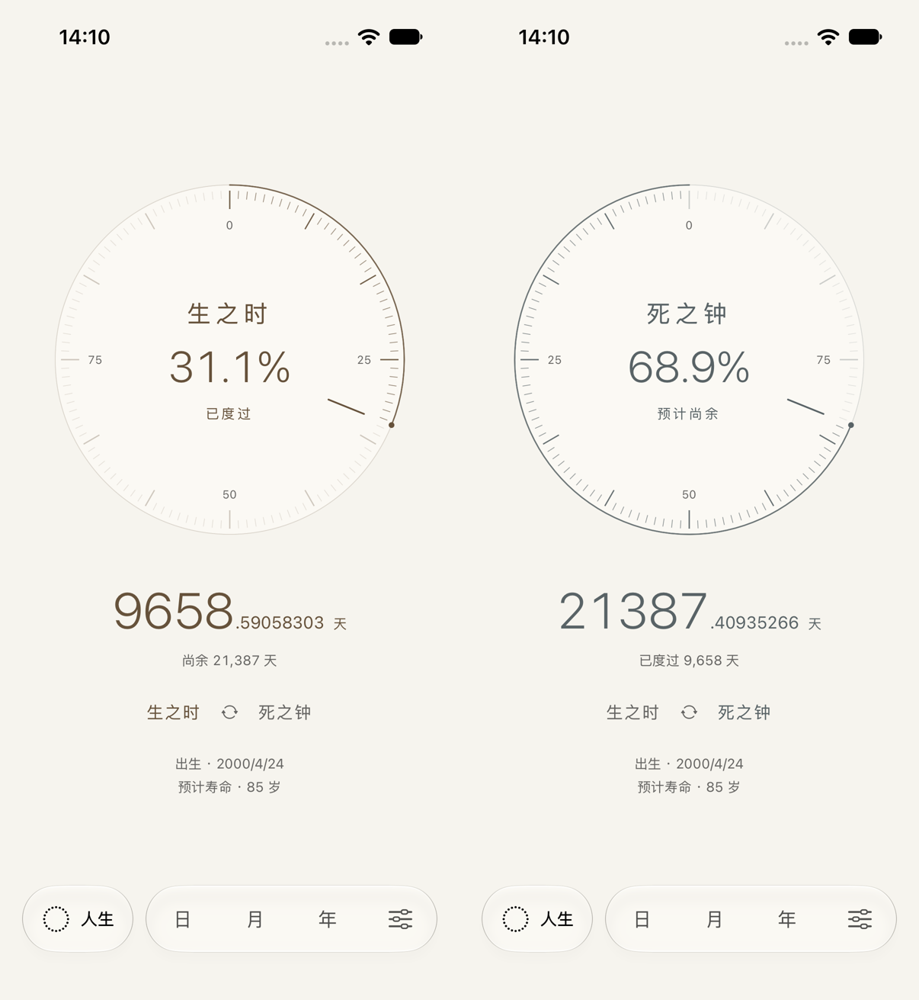

# 双面人生时钟 · 当前设计

2026-10-03，在现有 SwiftUI 工程与未提交成果上实现。根据用户描述的「钟表两面」关系重构，没有提供参考 App 的名称或原图，因此不宣称像素级复刻。

## 设计与交互

删除纸张轮廓、折痕和曲面动画。人生页以一只圆形时钟作为主体，标题与百分比置于钟心，精确天数位于钟面下方。正面「生之时」强调已经度过的圆周及刻度，背面「死之钟」强调预计尚余的部分；两面共享真实此刻指针，百分比互补。对面天数以低权重保留，出生与预计寿命集中在底部。

轻点钟面、读数或翻面按钮进行 0.65 秒缓入缓出半圈转动。背面文字保持正向，展示面根据实际转角决定，反向点击可沿原路径返回；没有延迟任务修改状态。减少动态效果直接切换。翻面触觉服从用户设置。

指针按真实人生进度移动，没有加速、呼吸或循环光效。两面的数字与百分比来自同一个采样时刻；前台可见时保持 10Hz，弹层与后台暂停，恢复直接读取当前时间。到达设定终点，尚余归零、生之时继续累计，显示「已达设定终点」。死之钟仍依据用户设置的预计寿命计算。

日月年保留抽象相界与双读数、日历刻点和缩放。独立人生入口、伸缩导航、设置、备份、数据模型与既有日期规则保留，没有第三方依赖或数据迁移。

## 图像与原速动态

- [正面](After/life-front-light.png)、[背面](After/dial-back-light.png)、[深色正面](After/life-front-dark.png)
- [紧凑屏](After/life-compact.png)、[最大辅助字号](After/compact-life-paper-large-text.png)（滚动后的背面读数）
- [36 秒原速翻面与四尺度](Motion/dial-and-scales-realtime.mp4)：仅裁切首尾，没有加速或重绘
- [完整原始录屏](Motion/dial-original.mp4)：保留测试启动／退出画面

普通字号在 iPhone SE 完整展示钟面、读数、翻面和计算依据。最大辅助字号采用小钟面与外置文字，主内容纵向滚动，导航固定。截图是模拟器真实 UI；`dial-pair.png` 仅将两张截图等比例并排。

## 实际验证

使用 macOS 27.0、Xcode 27.0。

| 设备／运行时 | 验证 | 结果 |
| --- | --- | --- |
| iPhone 17 Pro / iOS 27.0 | 49 项核心 + 8 项定向 UI | 57/57 通过 |
| iPhone 17 Pro / iOS 27.0 | 最终版原速翻面与四尺度录屏流程 | 1/1 通过 |
| iPhone SE 3 / iOS 26.3.1 | 最终版最大辅助字号与翻面／轻扫回归 | 2/2 通过 |
| iPhone SE 3 / iOS 26.3.1 | 减少动态效果下的四尺度／双读数 | 1/1 通过 |
| iPhone 17 Pro Max / iOS 26.3.1 | 最终版构建、启动与四尺度截图 | 通过 |

核心新增互补刻度、真实微小角位移、终点钳制与展示转角测试。UI 覆盖同时可读取的两组事实及增减、翻面、导航与轻扫、设置返回、刻点编辑、到期状态、后台恢复和辅助字号。结果摘要位于 `Results/`；主要原始测试结果为 `/tmp/KeduDialRegression.xcresult`、`/tmp/KeduDialMotion.xcresult`、`/tmp/KeduDialCompactVerified.xcresult`。

紧凑屏中间回归曾因读取翻面动画完成前的元素尺寸、以及要求最大字号读数初始就可点击而失败。改为等待实际展示面完成，并滚动到目标读数；缩小辅助字号钟面、将说明置于外侧、将翻面按钮改为单一动作。最后两项复测通过。中间失败不计入通过结果。

本轮是定向回归，没有重新执行此前全部 27 项 UI 成熟度流程或生成最新 Release Archive。浅深主题与辅助字号已检查；系统 VoiceOver 实际朗读、真机触觉／性能、iOS 18 运行时与正式发行仍未验证。此前成熟度与发行限制见 [审查记录](../2026-10-03-release-audit/README.md)。

商店目录前四张图已更新为最终版，1320×2868 RGB PNG；设置和刻点集沿用未改动的同日截图。被替换的纸张四图保存在 `Before/`。本轮没有发布或上传。
