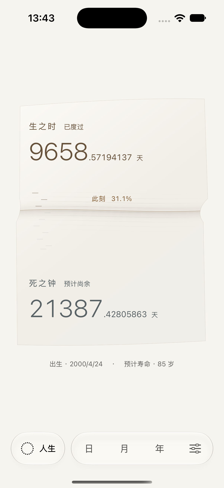

# 时间折面 · 主体验重构

2026-10-03。在现有工程与未提交成果上完成，本轮不改变时间模型、持久化、备份或设置流程，不增加依赖。

## 意象与构图

采用一张连续的「时间折面」。生之时与死之钟是同一表面的两种状态，此刻是连接两面的浅折痕。取双面关系的启发，重新构造为连续、同时可见的主体；没有恢复钟表翻面交互。

- 两组读数嵌入同一轮廓、共用左侧排版轴线，整体居于页面中部。
- 浅色保留暖纸，深色保持石墨。表面的微小曲率、温度与明暗变化建立形体，数字始终清晰。
- 出生与预计寿命合成主体下方的一组计算依据，窄屏与大字号按需分行。
- 中部刻痕区承载真实区间，折痕按当前真实进度定位。读数区为可读性预留固定空间，整个折面面积不充当进度百分比。
- 日、月、年、人生共用折面、位置插值与纹理密度规则；日月年刻点仍有分组菜单与至少 44pt 点击区域。

## Motion 与辅助功能

折痕具有极浅的厚度，曲率缓慢变化，少量细线穿过界面。局部绘制最高 30fps，低电量模式 15fps；局部表面流动与真实边界推进分开，生命进度不加速。数字仍以 10Hz 采样同一个真实时刻，连续视图树与原有 0.55 秒尺度过渡保留。

弹层、后台、减少动态效果与设定终点暂停局部动态。恢复直接采样当前时间。整数、小数与单位继续分层，不对跨尺度数值做补间，也不逐帧触发触觉或自动播报。

最大辅助字号下，标题、说明和读数可分行；主体随内容增长并允许滚动，底部导航固定。窄屏标题不再压缩到缺字。保持生之时 → 此刻 → 死之钟 → 计算依据的语义顺序。

## 实际运行材料

[石墨](After/life-dark.png)、[iPhone SE](After/life-compact.png)、[SE 最大字号上部](After/life-compact-largest.png)、[SE 最大字号下部](After/compact-life-paper-large-text.png)、[减少动态效果](After/reduce-motion.png)。

[日](After/day.png)、[月](After/month.png)、[年](After/year.png)共用同一形体。

[21 秒人生原速录屏](Motion/life-fold-native.mp4)与[折痕局部原速 GIF](Motion/fold-detail.gif)。视频读取实际时间；GIF 只裁剪、降低分辨率和帧率，未改变播放速度。短期人生边界位移可能小于一个像素，可见局部流动不表示寿命倒数被加速。

[四尺度原速录屏](Motion/four-scales-native.mp4)使用 UI 测试点击导航，保留启动与退出片段；没有时间加速。

商店草稿的前四张 1320×2868 RGB 截图已同步；原四张留于 `Before/store-*.png`。设置与刻点集图片仍对应未变动的界面。旧审查与旧视觉材料保留为历史记录。

## 验证

实际设备：iPhone 17 Pro / iOS 27.0、iPhone SE（第三代）/ iOS 26.3.1 模拟器；额外在 iPhone 17 Pro Max / iOS 26.3.1 捕获大屏原生截图与人生录屏。Xcode 27，Debug 构建与启动成功。

46 条核心测试与 12 个不同 UI 流程分批通过，范围包括：八位小数读数增减与互补、设置遮挡与后台恢复、四尺度选择、拖动与轻扫、刻点编辑、终点、减少动态效果、最大辅助字号与固定导航。原始汇总在 `Results`，不是宣称一次完整测试全绿。

| 运行 | 结果 |
| --- | --- |
| `/tmp/KeduFoldRegression.xcresult` | 54/55：46 核心通过，8 UI 通过；后台用例在旧朗读标签断言处停止 |
| `/tmp/KeduFoldCompact.xcresult` | 3/3：最大字号、读数、固定导航通过 |
| `/tmp/KeduFoldFinal.xcresult` | 3/4：最终字号布局与两项四尺度检查通过；尚余标签的旧标点断言已随后同步 |
| `/tmp/KeduFoldLifecycle.xcresult` | 1/1：同步两项标签后，实际后台恢复通过 |
| `/tmp/KeduFoldMotion.xcresult` | 1/1：四尺度录屏驱动复测通过 |

两次标签失败均为新语义标签改用逗号停顿后，测试仍期待旧中点分隔符；已更新两项断言。最大字号截字问题另行修复并由实际截图与标准／紧凑回归确认。

`Results/motion-pixels.json` 记录同一折痕区域的像素比较：减少动态效果相隔截图只有 44 个像素出现最大 1/255 的通道差，符合真实边界亚像素推进的绘制误差，没有局部流动；正常模式相隔 16 秒有 80,298 个像素出现至少 3/255 的通道变化。数字区未参与这一比较。

未验证：真机 VoiceOver 实际朗读、触觉、能耗、iOS 18 运行时。本轮未重新制作 Release Archive 或执行发行提交；上一轮成熟度结论及发行前事项仍见 [成熟度记录](../2026-10-03-release-audit/README.md)。
