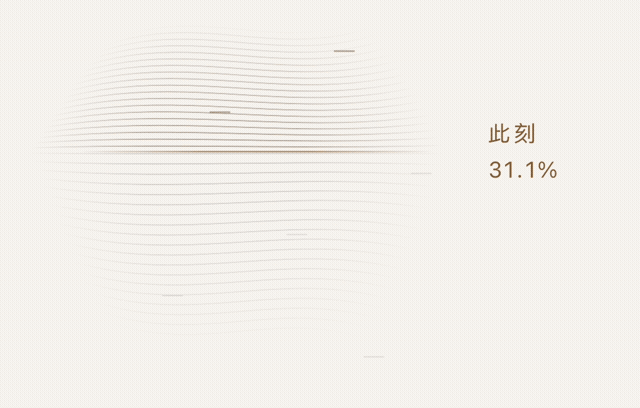
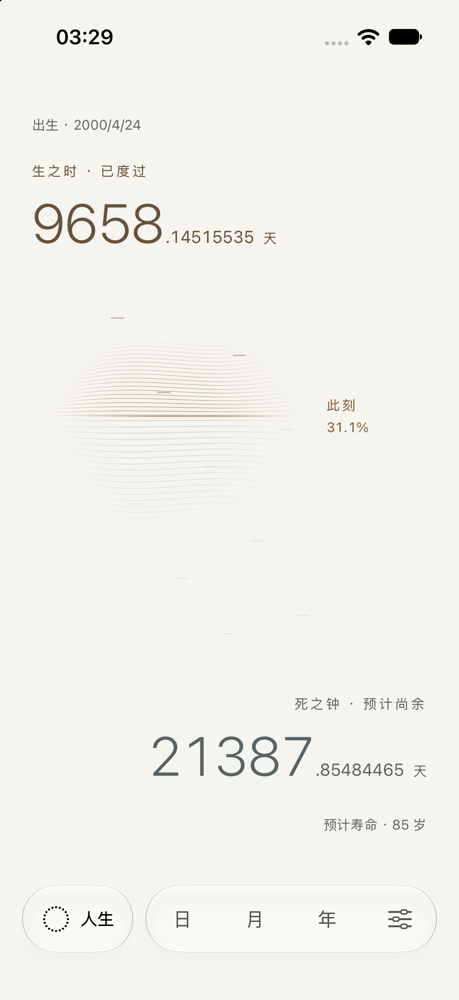
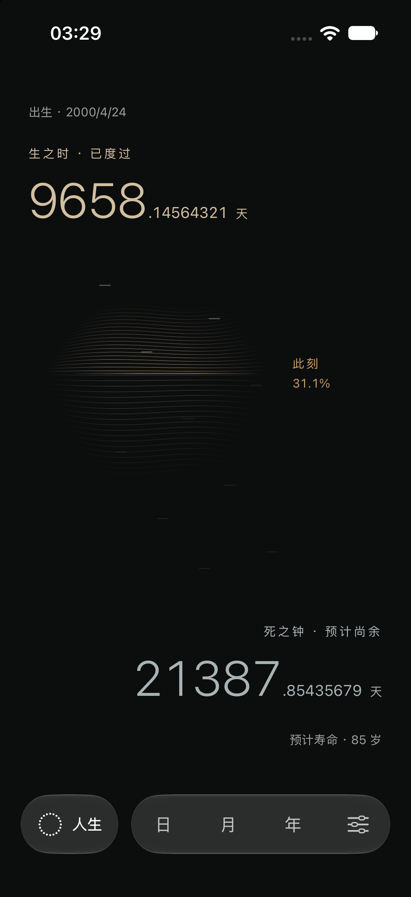

# 流动的时间层纹 · 2026-10-03

人生页中间从单条界面发展为一片细密的抽象层纹。38 条渐隐曲线从未来向过去缓慢通过此刻，过去一侧的间距压缩、对比度提高；未来一侧更疏、更轻。曲率很浅，没有实体隐喻、光效或额外交互。

「此刻」与百分比移至层纹右侧。层纹是局部时间流动的表达，不承担人生比例：真实边界仍严格按出生与预计终点定位，人生时钟与八位小数读数没有加速。

## 实现与构图

- 主视觉落在此刻附近的一片薄层；上下读数仍是事实信息。非对称布局与充足留白保留有限区间的空间关系。
- 四尺度继续共用 `TimePhaseField`；层纹宽度随缩放插值，真实日历颗粒和原生刻点交互层继续独立存在。
- 叶子视图 `PhaseLamination` 使用最高 30fps 的 `TimelineView` 和 Canvas，只绘制 38 条曲线。使用固定时间原点保持流动相位连续，不在帧内读取 SwiftData、计算日历或格式化数字。
- 前后台和弹层活动状态控制刷新；减少动态效果、到期及设置概览保留静态层纹。所有纹理对 VoiceOver 隐藏，此刻与数字的阅读语义保持不变。
- 原有八位小数每 0.1 秒采样；真正的边界与标签仍由同一真实采样时刻决定。

构图审查采用 `composition-director` 的单一视觉重心、层级和负空间检查；实现采用 `swiftui-performance-audit` 的局部刷新与稳定交互原则。没有新增依赖、源文件或持久化字段。

## 实际审阅

[18 秒原速完整录屏](life-flow.mp4)来自 iPhone 17 Pro / iOS 27 模拟器，测试内存资料。视频与局部 GIF 仅截取、裁切和编码，没有改变时间速度。

| 暖纸 | 石墨 |
| --- | --- |
|  |  |

紧凑屏：[常规字号](compact-life.png)、[最大辅助字号累计](compact-large-text-past.png)、[最大辅助字号尚余](compact-large-text-future.png)、[减少动态效果](reduce-motion.png)。

## 本次验证

iPhone SE 第三代 / iOS 26.3.1：36 个核心测试与 4 个 UI 定向用例一次通过，0 失败。UI 覆盖最大辅助字号和导航、减少动态效果下四尺度、真实读数与尺度切换、设定终点与计算依据。[Xcode 摘要](verification.json)。

随后 3 个交互回归用例全部通过，覆盖原生刻点菜单跨尺度编辑、设置返回和后台恢复。本次合计 36 个核心、7 个 UI 用例通过。[交互回归摘要](interaction-verification.json)。

iPhone 17 Pro / iOS 27：构建安装、浅深主题截图与原速运动录屏检查。真机能耗、帧率 Instruments 测量和系统 VoiceOver 实际朗读尚未进行；30fps 是刷新上限，不是实测性能结论。
