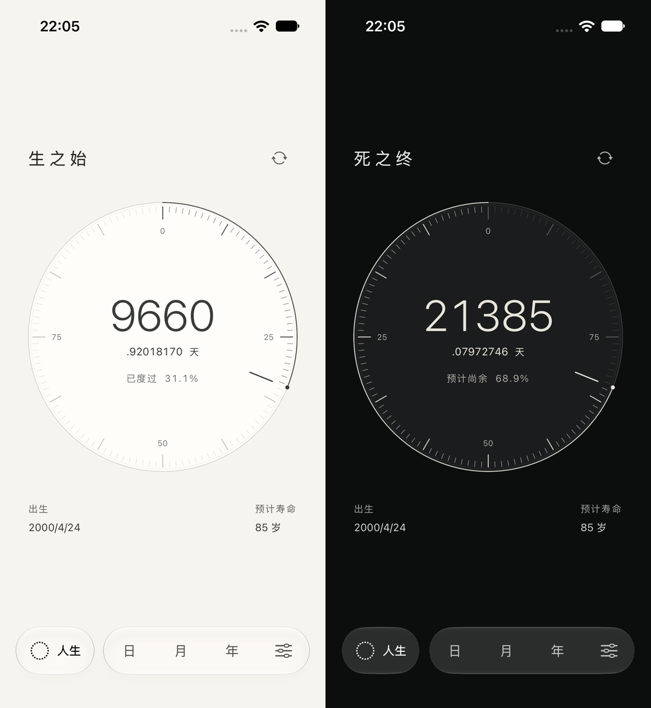

# 明暗双面 · 当前设计

2026-10-05，继续在既有工程与未提交成果上实现，没有新建项目或引入依赖。

## 视觉与信息

使用用户最新名称「生之始／死之终」。生之始为明亮钟面与深色读数，死之终为石墨钟面与浅色读数，同时切入深色环境；用户选择石墨外观时，生之始仍保留明亮钟面。区别来自明暗与空间，不增加情绪标语。

每面只显示自己的名称、精确天数和百分比。删除对面天数与双名称切换栏，名称只出现一次；中性翻面图标位于标题旁。大数字收进钟心，八位小数与单位位于下一行，进度降为次级读数。出生与预计寿命按两列对齐标题和钟面外缘。薄双层表缘、分级刻度、局部此刻指针构成一个完整主体，没有装饰光效。

翻面仍为 0.65 秒缓入缓出。只有钟面转动，标题在实际展示角度过半后切换，文字保持正向。每个时刻仅有一个面的数字出现在视图及辅助功能树中。数字来自原有 10Hz 真实采样；减少动态效果直接切换，后台与弹层暂停刷新。终点后尚余归零、累计继续，并保留「已达设定终点」。

明暗切换不写入外观偏好。系统状态栏跟随当前面；设置弹层、日月年遵循用户选择的主题，返回人生时保留当前面，离开人生再返回恢复生之始。设置、引导、计算说明同步名称与「并非死亡预测」的计算依据。

较大字号将读数移到钟面外，避免覆盖刻度。最大辅助字号可纵向滚动，导航固定，图标提供至少 44pt 点击区和「翻面」辅助功能动作。不自动播报每次数字更新。

## 真实 UI 与动态

- [生之始](After/front-light.png)、[死之终](After/back-graphite.png)
- [石墨偏好中的明亮正面](After/front-dark-appearance.png)
- [iPhone SE](After/compact-front-light.png)、[最大辅助字号](After/compact-life-paper-large-text.png)（滚动后的背面）
- [原速翻面与四尺度](Motion/faces-and-scales-realtime.mp4)：约 42 秒，只裁切首尾，没有加速
- [完整原始录屏](Motion/final-original.mp4)：保留测试启动及退出画面

截图为实际模拟器 UI；并排图只等比例缩放两张截图，没有重绘。人生与设置的 6.9 英寸目录截图已同步，旧图留存在 `Before/`；其余四张未改动的截图沿用 2026-10-03。

## 验证

使用 Xcode 27.0、macOS 27.0。结果摘要保存在 `Results/`。

| 设备／系统 | 执行范围 | 结果 |
| --- | --- | --- |
| iPhone 17 Pro / iOS 27.0 | 49 核心 + 原速动态流程 | 50/50 通过 |
| iPhone 17 Pro / iOS 27.0 | 独立面读数、翻面／轻扫／设置返回、两面后台恢复、减少动态效果、设定终点 | 5/5 通过 |
| iPhone 17 Pro / iOS 27.0 | 状态栏修正后再验翻面及四尺度 | 1/1 通过 |
| iPhone SE 3 / iOS 26.3.1 | 最终版最大辅助字号、翻面／轻扫／设置返回 | 2/2 通过 |
| iPhone 17 Pro Max / iOS 26.3.1 | 最终版构建与人生／设置截图 | 通过 |

共 49 个不同核心测试与 7 个不同 UI 流程，部分 UI 重复执行。测试更新为「每面仅自身数据」断言，不再要求两面信息同时存在。核心仍验证互补刻度、真实微小角位移、共享日期规则、备份与存储兼容。

首轮紧凑屏执行了缓存测试 Runner 的旧断言，日志仍要求已移除的「死之钟」名称及两组读数同时存在，而本地构建产物已包含新测试。只卸载 QA 模拟器的测试 Runner，重新安装执行后两项通过；没有删除用户数据。该失败不计入通过结果。视觉检查另发现深色背面状态栏未变白，将当前面外观偏好交给根视图统一管理后，最终截图和录屏确认已修正。

原始结果：`/tmp/KeduContrastMotion.xcresult`、`/tmp/KeduContrastRegression.xcresult`、`/tmp/KeduContrastFinal.xcresult`、`/tmp/KeduContrastCompactFinal.xcresult`。

本轮为主体验定向回归，未重新执行所有成熟度流程或生成最新 Release Archive。系统 VoiceOver 实际朗读、真机触觉／性能和 iOS 18 运行时未验证。既有发行限制仍见 [成熟度审查](../2026-10-03-release-audit/README.md)。没有提交、发布或上传。
