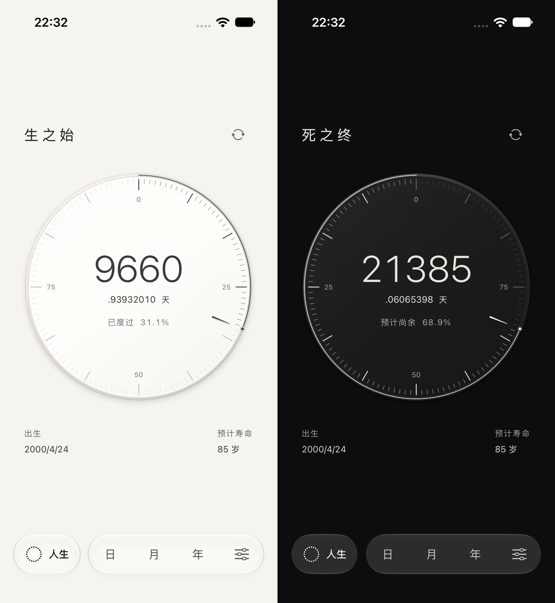

# 薄型表盘质感 · 当前

2026-10-05，在已有明暗两面与单面信息布局上细化表盘，仅修改 `LifeDialView.swift` 的 Canvas 绘制。

## 处理

- 细窄的缎面表缘与内侧倒角，盘面呈浅凹层次。
- 固定左上方受光，明面微暖、暗面石墨；渐变只用于极小的材质明暗差异。
- 主刻度稍厚，刻痕的下缘有微小受光，形成轻微压印感。
- 指针改为细窄渐收形状，配浅接触阴影及单侧亮边；此刻点增加细小底座与反光。
- 接触阴影贴近表缘，没有大范围光晕。数字、名称和百分比保持原来的锐利文字。

布局、数据、八位小数、互补进度、明暗切换与翻面逻辑保持此前实现。没有纹理定时器、随机颗粒、图片资产或第三方依赖；指针仍按真实时间推进。减少透明度时使用纯色盘面，取消接触阴影与微小受光层；辅助字号继续使用小钟面及外置读数。

## 实际 UI

[此前版本](Before/pair.png) · [明面](After/front-light.png) · [暗面](After/back-graphite.png) · [石墨外观中的明面](After/front-dark-appearance.png) · [紧凑屏／减少透明度](After/compact-reduced-transparency.png) · [最大辅助字号](After/compact-life-paper-large-text.png)

图片来自实际模拟器，拼图仅等比例缩放。商店目录人生图已同步，旧图保存在 `Before/store-life.png`。未重录动态视频；当前翻面节奏与 [较早的原速记录](../2026-10-05-contrast/Motion/faces-and-scales-realtime.mp4) 相同，该视频未包含本次材质。

## 验证

Xcode 27.0 / macOS 27.0。

| 设备／运行时 | 检查 | 结果 |
| --- | --- | --- |
| iPhone 17 Pro / iOS 27.0 | 明暗两面独立数据与增减，轻点翻面，轻扫导航，设置返回及外观恢复 | 2/2 UI 通过 |
| iPhone SE 3 / iOS 26.3.1 | 最大辅助字号、两面滚动读数与固定导航 | 1/1 UI 通过 |
| iPhone SE 3 / iOS 26.3.1 | 减少透明度与减少动态效果开启时的明面截图检查 | 通过 |
| iPhone 17 Pro Max / iOS 26.3.1 | 构建、启动与 1320×2868 人生截图 | 通过 |

结果摘要在 `Results/`。原始结果为 `/tmp/KeduMaterialFaces.xcresult` 与 `/tmp/KeduMaterialCompact.xcresult`。本次没有修改或新增测试，复用实际交互回归；未重复运行未修改的时间核心和全应用测试。最初紧凑屏截图过早捕获到区间尚未准备好的画面，已在区间就绪后重新捕获并目视确认。

真机材质效果、性能与能耗未实测；系统 VoiceOver 朗读和 iOS 18 运行时限制沿用 [明暗记录](../2026-10-05-contrast/README.md)。本次没有生成新发行 Archive，也没有发布。
